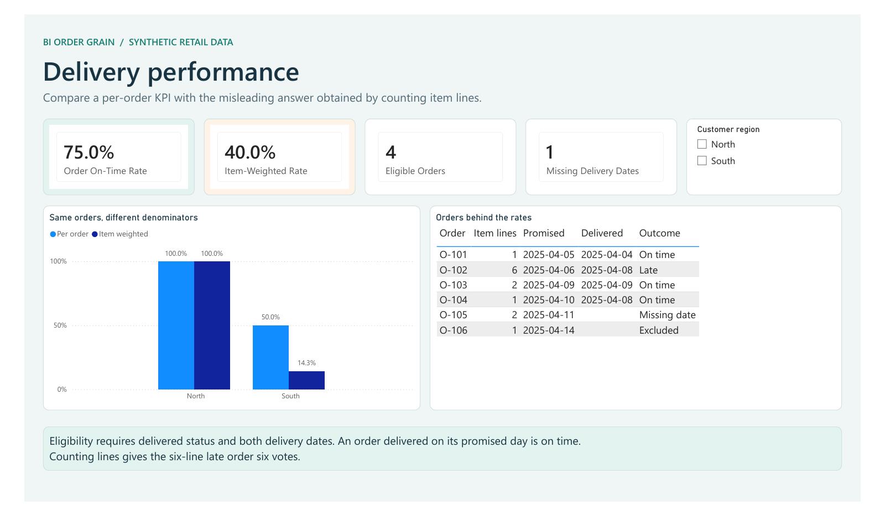
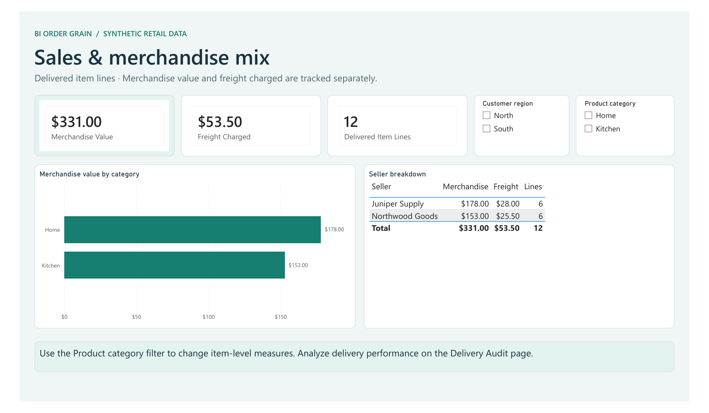

# BI Order Grain Demo

A standalone portfolio demo based on Shir Mamia's **BI Course Edition**. The example follows a fictional online retailer and shows how the unit of analysis changes the answer to a basic delivery question.

## Power BI report

[Download the PBIX](power-bi/bi-order-grain.pbix) and open it in Power BI Desktop. The report contains the synthetic data and runs without external connections or credentials.

**Delivery Audit** compares the order-level KPI with the item-weighted calculation. Select a customer region to see the denominators change and inspect the underlying orders.



**Sales & Mix** shows merchandise value, freight charged, and delivered item lines. The region and product-category slicers also filter the category chart and seller breakdown.



## The result

| Calculation | Numerator and denominator | Rate |
| --- | --- | ---: |
| On-time delivery per order | 3 on-time orders out of 4 eligible orders | **75.0%** |
| On-time delivery weighted by item lines | 4 on-time lines out of 10 eligible lines | **40.0%** |

One late order contains six items. A join to item lines repeats that order six times. The order KPI gives each eligible order one vote. Eligibility requires delivered status and both an actual and a promised delivery date. Delivery on the promised date counts as on time.

## Explore the demo

[Download the HTML report](https://github.com/ShirMamia/bi-order-grain-demo/raw/refs/heads/main/report.html) and open it in a browser. The region filter updates both calculations and shows the underlying orders. The report runs offline.

To regenerate the report and export the model tables, run these commands with **Python 3.10+** from the repository root. No packages or credentials are required.

```sh
python demo.py
python -m unittest -v
```

Open `build/report.html` and use the CSVs in `build/model/` for the Power BI walkthrough below. `model.sql` contains both fact views and the dimension definitions.

## Rebuild the model in Power BI

Import the six generated CSVs. Set date columns to Date, `on_time` and monetary cents to Whole number, and identifiers to Text. Preserve blank `on_time` values. Create single-direction, one-to-many relationships from the dimensions to the facts:

| Dimension key | Fact tables with that key |
| --- | --- |
| `DimDate[purchased_on]` | `FactOrder`, `FactOrderItem` |
| `DimCustomer[customer_id]` | `FactOrder`, `FactOrderItem` |
| `DimProduct[product_id]` | `FactOrderItem` |
| `DimSeller[seller_id]` | `FactOrderItem` |

The natural keys are `order_id` in `FactOrder` and `(order_id, line_no)` in `FactOrderItem`. Leave the two facts unrelated. Filter the delivery KPI by order date or customer region. Product category and seller apply to item measures.

```dax
On-Time Orders = SUM ( FactOrder[on_time] )
Eligible Orders = COUNT ( FactOrder[on_time] )
On-Time Rate = DIVIDE ( [On-Time Orders], [Eligible Orders] )
```

Create the measures individually and format `On-Time Rate` as a percentage. The HTML report implements the same rules through SQLite.

### Power BI Desktop verification

| Page and filter | Expected result |
| --- | --- |
| Sales & Mix · all regions and categories | $331.00 merchandise, $53.50 freight, 12 item lines |
| Sales & Mix · North | $105.00 merchandise, $16.00 freight, 3 item lines |
| Sales & Mix · Kitchen | $153.00 merchandise, $26.50 freight, 7 item lines |
| Delivery Audit · all regions | 75.0% per order, 40.0% item-weighted, 4 eligible orders |
| Delivery Audit · South | 50.0% per order, 14.3% item-weighted, 2 eligible orders |

## Data

Every CSV in `data/` was written for this demo. Names, IDs, amounts, dates, and order scenarios are fictional. Merchandise amounts represent the item sale value, with freight tracked separately.
